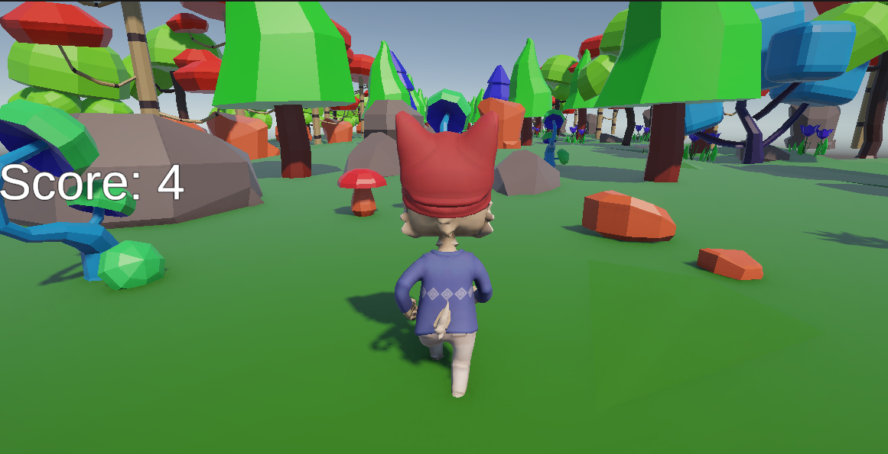

# 3D Infinite Runner

Unity で制作した 3D エンドレスランゲームです。  
自動で前進し続けるキャラクターを左右移動・ジャンプで操作し、障害物を避けながらアイテムを集めてスコアを競います。

<div align="left">
  
</div>

---

## 目次

- [概要](#概要)
- [開発情報](#開発情報)
- [プレイ方法](#プレイ方法)
- [使用技術](#使用技術)
- [実装内容](#実装内容)
- [こだわり・工夫](#こだわり工夫)
- [ディレクトリ構成](#ディレクトリ構成)
- [使用アセット](#使用アセット)

---

## 概要

### どんなゲームか

| 項目 | 詳細 |
|------|------|
| ジャンル | 3D エンドレスランゲーム |
| プラットフォーム | PC（Windows） |

1. タイトル画面からゲームを開始
2. 2 秒のカウントダウン後、キャラクターが自動で前進（時間経過で加速）
3. 左右移動で障害物を回避し、ジャンプで高い障害物を乗り越える
4. フィールド上のアイテムを収集してスコアを稼ぐ
5. 障害物に衝突するとゲームオーバー → リザルト画面を表示
   - 今回のスコア・ベストスコアを確認
   - ベストスコア更新時は「NEW RECORD」を表示
6. リスタートボタンでゲームに戻る


---

## 開発情報

| 項目 | 詳細 |
|------|------|
| 開発期間 | 2週間 |
| 開発人数 | 1 人（個人開発） |
| 担当 | 企画・プログラミング・レベルデザインを含む全工程（グラフィック・サウンドは外部アセットを使用） |

---

## プレイ方法

### 公開リンク / ダウンロード

> *(公開リンク・ビルドのダウンロード先をここに追加)*

### プレイ動画

> [](https://www.youtube.com/watch?v=xR2BBAW758A)

### 動作環境

- Unity 6 (6000.3.11f1) 以降
- Universal Render Pipeline サポート環境

### Unity エディタで起動する手順

```bash
# 1. リポジトリのクローン
git clone https://github.com/nasu-cell/3DRunGame.git

# 2. Unity Hub でプロジェクトを開く
#    [Open] → クローンしたフォルダを選択

# 3. Unity バージョンを確認
#    Unity 6000.3.11f1 以降を使用（バージョン不一致時はアップグレードを選択）

# 4. TitleScene を開く
#    Assets/Scenes/TitleScene.unity を開く

# 5. Play ボタンでゲーム開始
```

> **注意:** Unity のバージョンが異なる場合、プロジェクトのアップグレードダイアログが表示されます。  
> 推奨バージョン以降であれば「Upgrade」を選択してください。

### 操作方法

| 操作 | キー |
|------|------|
| 左移動 | `A` / `←` |
| 右移動 | `D` / `→` |
| ジャンプ | `Space` |

---

## 使用技術

| カテゴリ | 技術 |
|----------|------|
| **ゲームエンジン** | Unity 6 (6000.3.11f1) |
| **言語** | C# |
| **グラフィクス** | Universal Render Pipeline (URP) 17.3.0 |
| **UI** | uGUI 2.0.0 / TextMesh Pro |
| **入力** | Input Manager（`Input.GetKey` 系 API） |
| **アニメーション** | Unity Animator (State Machine) |
| **物理演算** | Unity Physics (Rigidbody / Collider) |
| **バージョン管理** | Git / GitHub |
| **開発環境** | Windows 11 / Visual Studio |

---

## 実装内容

### 全体構成

```
PlayerMovement      ゲーム状態 (isGamePlaying) を管理・プレイヤー制御
      │
      ├─ ObstacleCrush    衝突検知 → PlayerMovement.GameOver()
      │
GameManager         スコア計算・音声再生・リザルト処理を一元管理
      │
      ├─ Collectable      アイテム回転 + 取得検知 → GameManager.UpdateScore()
      │
      ├─ UIManager        リザルトパネルの表示制御
      │
      └─ BestScoreRecord  ベストスコアを DontDestroyOnLoad で永続保持（Singleton）

GenerateLevels      3 秒ごとにランダムなレベル Prefab を無限生成
      │
Sweeper             通過済みレベルオブジェクトを自動削除してメモリを解放

MySceneManager      ボタンからのシーン遷移を管理
LoadScene           ロードシーン経由で GameScene へ自動遷移
```

### 1. 無限コースの生成

`GenerateLevels.cs` で、4 種類のレベル Prefab（`StartingLevel` / `Level (1)`〜`(3)`）からランダムに 1 つを選び、前方 12 ユニット間隔で連続生成しています。生成処理は Coroutine で 3 秒ごとに実行されます。

```csharp
IEnumerator GenerateLvl()
{
    lvlNum = Random.Range(0, 4);
    Instantiate(level[lvlNum], new Vector3(0, 0, zPos), Quaternion.identity);
    zPos += 12;
    yield return new WaitForSeconds(3);
    creatingLevel = false;
}
```

### 2. 通過済みレベルの削除

プレイヤーの後方に配置した `Sweeper.cs` のトリガーに、`Level` タグを持つオブジェクトが触れると `Destroy` します。

```csharp
public void OnTriggerEnter(Collider collision)
{
    if (collision.gameObject.CompareTag("Level"))
        Destroy(collision.gameObject);
}
```

### 3. 物理ベースのジャンプ

`Rigidbody.AddForce` に `ForceMode.Impulse` を使用して放物線軌道のジャンプを実現しています。`OnCollisionStay` / `OnCollisionExit` で接地判定を行います。

```csharp
if (Input.GetKeyDown(KeyCode.Space) && isGrounded)
{
    rb.AddForce(jump * jumpForce, ForceMode.Impulse);
    isGrounded = false;
}
```

### 4. 時間経過による加速

前進処理のたびに移動速度へ加速度を加算し、プレイ時間に応じて速度が上がります。

```csharp
transform.Translate(Vector3.forward * Time.deltaTime * moveSpeed, Space.World);
moveSpeed += Time.deltaTime * acceleration;
```

### 5. リザルト画面とベストスコア

ゲームオーバー時に今回のスコアとベストスコアを比較し、`UIManager` 経由でリザルト画面に表示します。

```csharp
// GameManager.cs
public void Result()
{
    if (score > bestScoreRecord.bestScore)
    {
        isChangeRecord = true;
        bestScoreRecord.bestScore = score;
    }
    uiManager.ResultShow(score, bestScoreRecord.bestScore, isChangeRecord);
}
```

### 6. アニメーション制御

Animator Controller で走り・ジャンプ・アイドルのステートマシンを構築し、スクリプトからは `SetTrigger("a_Jump")` / `SetBool("a_Idle", true)` で遷移を指示しています。

---

## こだわり・工夫

### 生成負荷とゲームテンポの両立

- **課題:** 毎フレーム生成判定を行うと、不要な生成が重なり負荷が増える
- **解決:** Coroutine とフラグ (`creatingLevel`) で生成間隔を制御し、一定のテンポでコースを供給

### 無限生成によるメモリ増大の防止

- **課題:** レベルを生成し続けるとオブジェクトが際限なく増える
- **解決:** 破棄専用の `Sweeper` を用意し、通過済みレベルを削除
- **設計意図:** 生成 (`GenerateLevels`) と破棄 (`Sweeper`) を別コンポーネントに分け、単一責任の原則に沿わせた

### 多段ジャンプの防止

- **課題:** 空中でもジャンプ入力を受け付けると、無限に上昇できてしまう
- **解決:** 衝突コールバックで接地状態を管理し、接地中のみジャンプを許可

### シーンをまたぐベストスコアの保持

- **課題:** リスタートでシーンを読み直すと、スコア情報が破棄される
- **解決:** `BestScoreRecord` を `DontDestroyOnLoad` を適用した Singleton にし、シーン遷移後もベストスコアを保持

### 疎結合なコンポーネント設計

- **設計意図:** 各スクリプトに単一の責務を持たせ、スコアとオーディオは `GameManager` に集約して、コンポーネント間の参照を最小限にした
- アニメーションの遷移ロジックは Animator Controller 側に置き、スクリプトは遷移の指示だけを行う

### 今後の課題

- [ ] ベストスコアの永続保存（PlayerPrefs）— 現在はセッション内のみ保持
- [ ] モバイル向けスワイプ・タップ操作対応
- [ ] オブジェクトプーリングによる `Instantiate` / `Destroy` コストの削減
- [ ] レベルバリエーションの追加

---

## ディレクトリ構成

```
Assets/
├── Animations/               # キャラクターアニメーション (idle / run / jump)
├── Materials/                # マテリアル・シェーダー設定
├── Prefabs/                  # ゲームオブジェクトテンプレート
│   ├── StartingLevel.prefab  # 開始レベル（ランダム生成の候補にも含む）
│   ├── Level (1-3).prefab    # ランダム生成レベル
│   ├── Collectable.prefab    # 収集アイテム
│   ├── character.prefab      # プレイヤーキャラクター
│   └── BestScoreRecord.prefab # ベストスコア保持オブジェクト（DontDestroyOnLoad）
├── Scenes/                   # ゲームシーン
│   ├── TitleScene.unity      # タイトル画面
│   ├── LoadScene.unity       # ロード用中継シーン
│   └── GameScene.unity       # ゲーム本体
├── Scripts/                  # C# スクリプト
│   ├── PlayerMovemet.cs      # プレイヤー制御・ゲーム状態管理
│   ├── GameManager.cs        # スコア・オーディオ・リザルト管理
│   ├── UIManager.cs          # リザルト画面の UI 表示制御
│   ├── BestScoreRecord.cs    # ベストスコアの Singleton 管理
│   ├── GenerateLevels.cs     # レベルのランダム生成
│   ├── Collectable.cs        # アイテム取得処理
│   ├── ObstacleCrush.cs      # 障害物衝突・ゲームオーバー検知
│   ├── Sweeper.cs            # 通過済みレベルの自動削除
│   ├── MySceneManager.cs     # ボタンからのシーン遷移
│   └── LoadScene.cs          # ロードシーンでの自動シーン遷移
└── Settings/                 # URP レンダリング設定
```

外部アセットは [使用アセット](#使用アセット) を参照してください。


## 使用アセット

| 素材名 | 用途 | ライセンス |
|--------|------|------------|
| [Supercyan Character Pack Animal People Sample](https://assetstore.unity.com/packages/3d/characters/supercyan-character-pack-animal-people-sample-136183) | プレイヤーキャラクター | Unity Asset Store EULA |
| Forest Pack | 背景・ステージ | Unity Asset Store EULA |
| Casual SoundFX Pack | 効果音 | Unity Asset Store EULA |
| Free Orchestral Music Pack | BGM | Unity Asset Store EULA |

本プロジェクトに含まれるサードパーティアセットは、各提供元のライセンスに従います。
